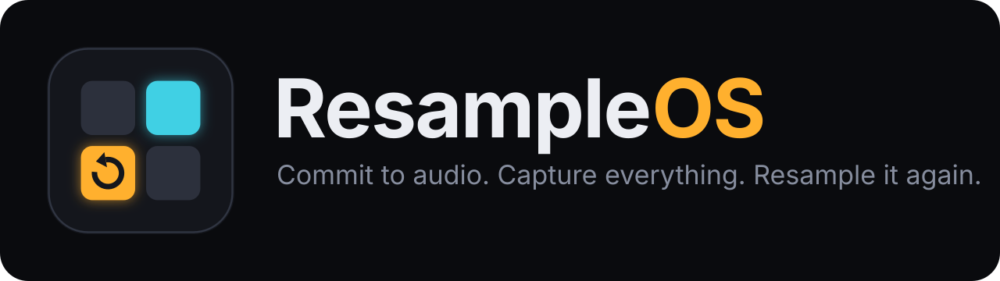
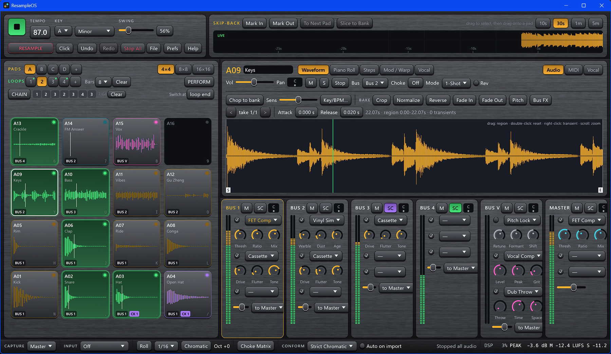
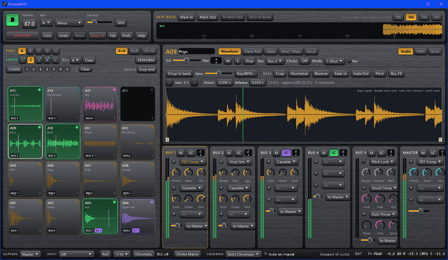
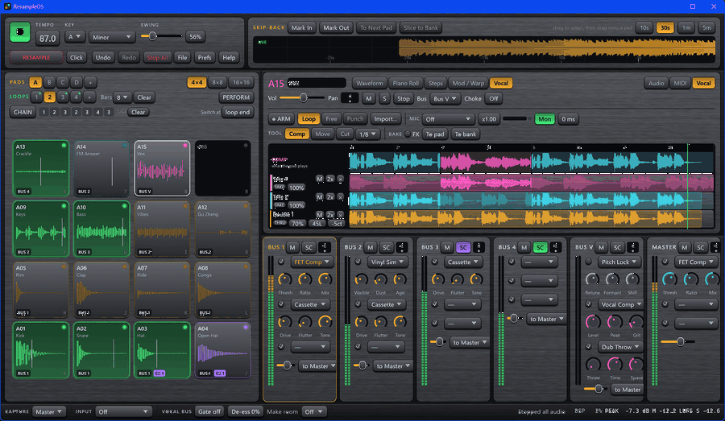
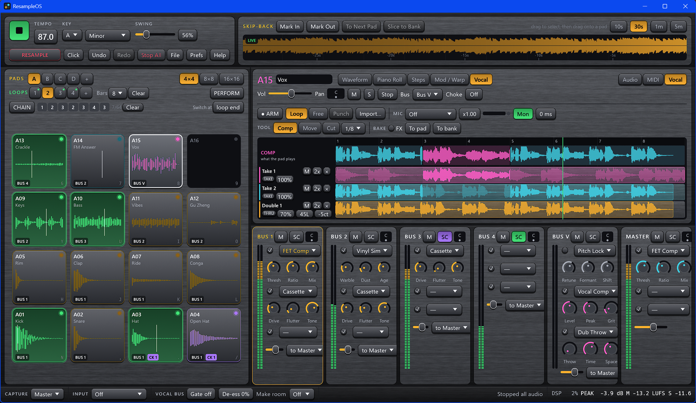
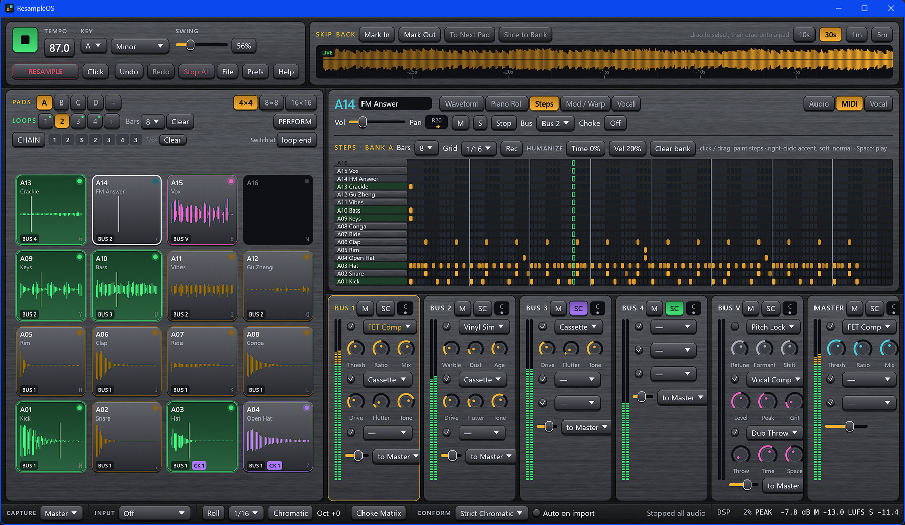
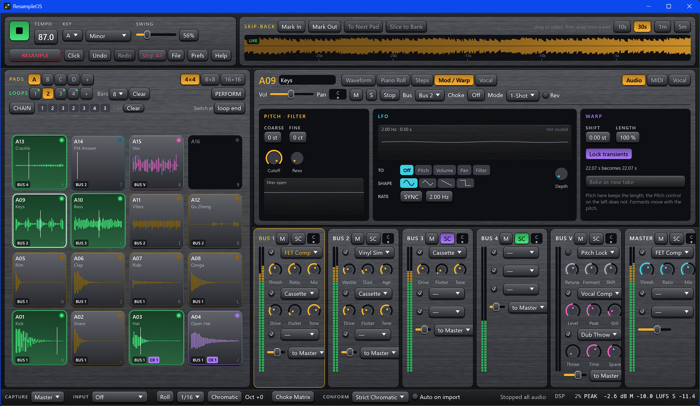
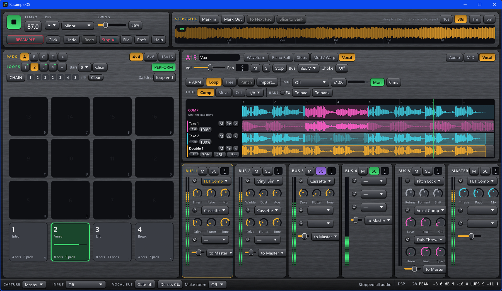

<p align="center">
  
</p>

ResampleOS is a pad-based DAW built around committing to audio. Linear DAWs make destructive work slow; hardware samplers make it fast but run out of pads, polyphony and screen. ResampleOS takes the sampler workflow (chop, resample, bake, repeat) and gives it unlimited banks, a piano roll, a step sequencer, plugin hosting and a capture buffer that never stops recording.



| | |
| --- | --- |
|  |  |
| Pads light as they sound, and the skip-back buffer is always recording | Swipe across a take to put that stretch of it in the comp |
|  |  |
| Vocal takes, comp and doubles | Step sequencer for the whole bank |
|  |  |
| Filter, LFO and warp per pad | Perform mode: the pads launch loops |

A short tour of the tabs: [demo-tour.gif](docs/images/demo-tour.gif).

> **Status: pre-release.** ResampleOS is developed and tested on Windows 11. It is written with cross-platform libraries, but it has not been built or run on macOS or Linux, and the plugin editor windows, icon embedding and UI font loading are Windows-specific today.

## What it does

- **Pads and banks.** A 4×4 pad matrix per bank, with banks A to Z, then AA onwards (64 in all). Zoom out to 8×8 or 16×16 to see several banks at once.
- **Resample to a pad.** Arm, hit the destination pad, perform, and the result (pads, bus effects and all) is baked onto that pad. If the transport is running the take starts on the next downbeat and is trimmed to whole bars.
- **Skip-back.** The last five minutes of output are always in memory. Grab the last 16 bars with one key, or drag a selection from the top-bar waveform onto a pad.
- **Take stack.** Every destructive edit (crop, reverse, normalize, pitch, conform, baked effects) becomes a new take. Each pad keeps 16 and can step back through them on its own.
- **Key and tempo conform.** Samples are analysed on load for tempo, key and transients. One action stretches and re-pitches a sample to the project, keeping transients intact.
- **Transient chop.** One key spreads a sample's slices across the next empty bank.
- **Piano roll and step sequencer.** Scale-locked piano roll with a velocity lane and free microtiming; a step grid per bank for drum patterns; swing and humanize on top.
- **Loops, chain and perform mode.** Up to sixteen loops of 1 to 16 bars over the same pads, switched on the beat, chained into an arrangement, or launched live from the pads.
- **Vocal takes.** A vocal pad records a take each time round the loop, with swipe comping, cut, move and slip editing, doubles, and baking to a pad or to a bank of phrases. A dedicated vocal bus has scale-locked pitch correction, levelling and a dub throw.
- **Performance buses.** Four buses, a vocal bus and a master, three effect slots each: vinyl, cassette, 3-band EQ, DJ isolator and filter, bit-crush, compressor, tape delay, reverb. Buses can feed later buses and can be sidechained from one another.
- **VST3 hosting.** Instruments on pads and effects on buses, with a scanner that copes with libraries of a thousand plugins or more.
- **External input**, **MIDI controllers**, **project-wide undo and redo**.

## Getting started

You need [Rust](https://rustup.rs) 1.88 or newer and, on Windows, the MSVC build tools.

```bash
git clone <this repository>
cd ResampleOS
cargo run --release
```

The first build takes a few minutes. Audio files given on the command line load onto pads starting at A01:

```bash
cargo run --release -- loop.wav kick.wav snare.wav
```

A project folder opens that project instead:

```bash
cargo run --release -- path/to/project
```

To run the tests:

```bash
cargo test --release
```

## A five-minute tour

1. Drop a loop onto pad **A01**. Its tempo and key appear above the waveform.
2. Press **Ctrl+K**, then **Enter**: the loop is conformed to the project tempo and key as take 2.
3. Press **C**: its slices land on bank B.
4. Play the slices with **N , . /**, **H J K L**, **Y U I O** and **6 7 8 9** (the 4×4, bottom row first).
5. Press **R**, hit an empty pad on bank C, play something, press **R** again. That pad now holds what you played.
6. Select another empty pad, press **Tab**, and draw a bassline in the piano roll.
7. Press **G** to draw a drum pattern in the step sequencer, and **Space** to hear it all together.
8. Liked something you just heard? Press **S** to pull the last 16 bars onto a pad.

Press **F1** in the app for the shortcut list.

## Documentation

| | |
| --- | --- |
| [User guide](docs/USER_GUIDE.md) | Every part of the app, in the order you meet it |
| [Shortcuts and MIDI](docs/SHORTCUTS.md) | Keyboard reference and the controller mapping |
| [Architecture](docs/ARCHITECTURE.md) | How the engine, UI and plugin hosting fit together |
| [Contributing](CONTRIBUTING.md) | Building, testing and the conventions the code follows |

## Known limitations

- VST3 only: no VST2, CLAP or AU.
- Some VST3 effects load and show their editor but pass no audio. In testing this affected three of fourteen vendors. A silent effect mutes its bus.
- Hosted plugins are not crash-isolated once loaded; only scanning is.
- Changing the audio device, sample rate, buffer size or skip-back length takes effect after a restart.
- Pitch warps and vocal doubles move formants with the pitch. Only the Pitch Lock effect has separate formant control.
- Vocal recording has no automatic latency measurement: the input latency is set by hand. Monitoring through the app is as fast as the audio device allows, which on shared-mode Windows audio is not instant.
- The pitch correction and the vocal comp tools were verified with test signals and imported audio, not with a live microphone.
- Projects store each pad's active take, not its whole take stack.
- Hardware controllers get no LED feedback, and there is no controller mapping for vocal comping (the keyboard has one).

## License

ResampleOS is released under the [MIT License](LICENSE).

## Acknowledgements

ResampleOS is built on [egui](https://github.com/emilk/egui), [cpal](https://github.com/RustAudio/cpal), [symphonia](https://github.com/pdeljanov/Symphonia), [rustfft](https://github.com/ejmahler/RustFFT), [midir](https://github.com/Boddlnagg/midir), [rtrb](https://github.com/mgeier/rtrb) and [vst3-host](https://github.com/HelgeSverre/rust-vst3-host). VST is a trademark of Steinberg Media Technologies GmbH.
